# Case study: Modernizing POKSI without stopping it

*Code for everything below is in this repository; see [README.md](README.md) for what is where.*

## Summary

I moved POKSI, a Delphi desktop app for a pet boarding house, from a local SQLite file to a shared MySQL database. I then added a REST API and a web page for pet owners, all without switching the desktop app off. The Delphi app kept working the whole time. Ten control scenarios showed that both apps see the same data and follow the same rules.

|  |  |
| --- | --- |
| Role | Audit, migration, API, web page, testing, all done by me alone |
| Starting point | Delphi 12 FMX + FireDAC, SQLite, 4,142 lines of Pascal, 6 tables, 11 screens |
| Added | MySQL (MariaDB), Laravel 13 API on PHP 8.5, owner web page, Docker setup |
| Duration | October 2026, about one week of focused work |
| Bugs found | 19 in the audit (18 fixed before migration), 6 more during migration and testing |
| SQL queries changed for MySQL | 0 of about 80 in the screens |
| Automated tests | 49, run against the same schema the migration uses |
| Control scenarios | 10 of 10 passed in Delphi, on the web page and in the API |

I worked with an AI coding assistant as a pair programmer. Every change was built, run and checked by me on my own machine.

## About this project

POKSI comes from a team project at ASSŠ (Akademija strukovnih studija Šumadija, Academy of applied studies Šumadija, Serbia), and the Delphi desktop app was my part of it: I built the whole app myself. It was never used by a real business.

I chose it as a stand-in for a legacy system on purpose. It has the typical traits: data in one local file, business rules inside button handlers, and no tests. I also know its code well enough to judge the effect of every change.

The app is not a finished product. It covers what the course project needed, not everything a real boarding house would. All names, pets, accounts and numbers in this case study and in the screenshots are test data.

The method is the one I would use on a client's system. The only difference is that here no one's business depended on it.

## The starting point

POKSI ran on one computer, with its data in a SQLite file next to the program. That was fine for a course project, but a real boarding house needs more than one desk and a way for owners to see their pets.

The app handles a pet's whole stay. An admin checks a pet in and assigns a box. Staff log walks, meals and grooming, and meals are taken out of stock. At check-out the app prints a bill from the price list. Owners can log in and read their pet's diary.

Three things make it a realistic legacy case:

- **Data locked in one file.** No second computer, no web, no phone could reach it.
- **Business rules only in the screens.** Who may see what, how stock is reduced and how the bill is built lived in button click handlers, not in one place.
- **No tests and no written spec.** The code itself was the only description of how it behaves.

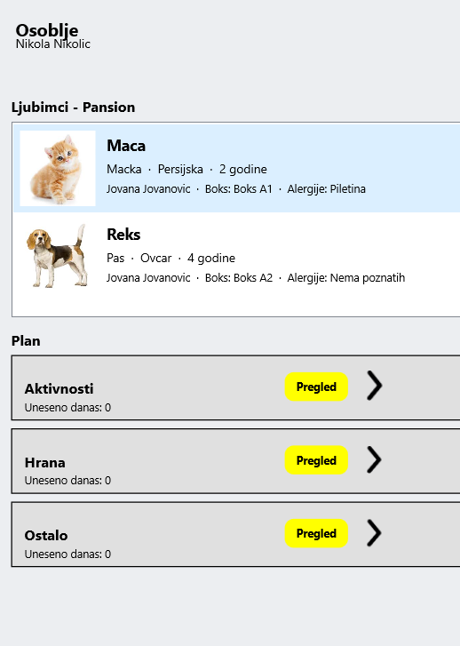

*The original staff screen: pets in the boarding house and today's plan, with all data in one local SQLite file.*

## The audit came first

Before changing anything, I read the whole project and wrote down what it does: every screen, which tables it reads and writes, and every business rule I could find in the code. This is the same document I would sell to a client as a paid first step.

The audit found 19 problems. I fixed 18 in the Delphi code before the migration. The last one, table names and missing foreign keys, was left for the move to MySQL.

| # | Problem | Why it mattered |
| --- | --- | --- |
| 1 | A new owner with no pets saw every other owner's pets and diaries | Privacy: any sign-up could read everyone's data |
| 3 | Passwords stored as plain text | Now SHA-256 hashes; old ones convert on first start |
| 5 | "1,5 kg" took 1 g out of stock, "0,5 l" took nothing | Stock numbers drifted from reality |
| 7 | Not enough stock set the level to 0 and still logged the meal | Food was "used" that never existed |
| 8 | Meal entry and stock change were not in one transaction | A crash between them left the two out of step |
| 9 | A new activity could start while one was still running | The old one stayed open forever; the worker always looked busy |

The audit also became the rule book for the new parts. The API and the web page had to follow the same rules as Delphi, so I wrote each rule down once, with the place in the code where it lives.

## Approach: replace it piece by piece

I used the strangler fig pattern: the old app keeps running while new parts grow around it, and nothing is switched off until the new part has proven it does the same job.

- **One database for both.** Delphi and the new API read and write the same MySQL tables, so there is no sync job and no second copy of the data.
- **Same table and column names.** The MySQL schema keeps the Delphi names (`pets`, `DNEVNA_AKTIVNOST`, ...). Delphi could switch databases by changing only its connection.
- **A way back.** A setting in `poksi.ini` picks MySQL or the old SQLite file. Until the new setup proved itself, going back took one line.
- **Same rules in both apps.** Every rule from the audit exists once in Delphi and once in the API, and the tests and control scenarios check that both give the same answer.

## What was built

The work went in four steps. Each one ended with something running and checked before the next began.

**1. SQLite to MySQL.** A Python script (`migrate.py`) reads every table, converts the data and writes it to MySQL in one transaction. A second script (`verify.py`) compares row counts and checksums for all 6 tables. The schema got real types (`DECIMAL` for money, `DATETIME` for dates), `utf8mb4` for Serbian letters, and foreign keys that are actually enforced. After the switch, the migration script refuses to run on a database that already holds data, so it cannot wipe existing data by accident.

**2. Delphi on MySQL, over TLS.** Delphi talks to MySQL through FireDAC and the MariaDB client library. The connection is encrypted with TLS, and Delphi checks that the server certificate was signed by our own CA. None of the roughly 80 SQL queries in the screens had to change. Only the startup code that created tables and test data was tied to SQLite.

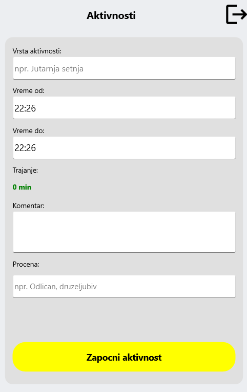

*Before: staff typed the activity name by hand and had to enter the comment and rating before the activity even started.*

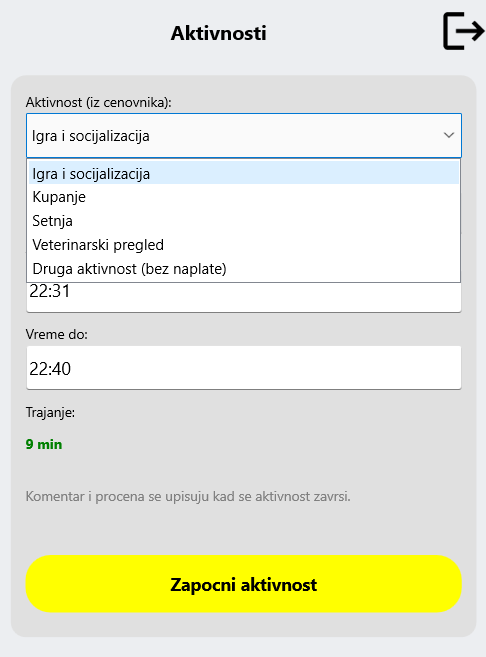

*After: the activity is picked from the price list, so the bill always matches it. Unpaid activities have their own entry.*

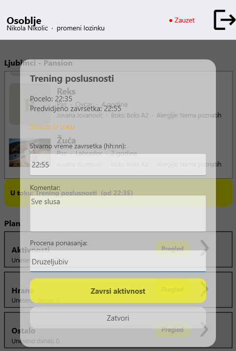

*The comment and the behaviour rating are now entered when the activity ends, when staff actually know how it went.*

**3. Laravel API.** A REST API (Laravel 13, PHP 8.5) works on the existing tables with no renames. It uses token login (Sanctum), roles for admin, staff and owner, and the same password hashing as Delphi. An owner who asks for someone else's pet gets 404, not 403, so they cannot even learn that the pet exists. Staff that an admin deactivates in Delphi lose API access at once, because the role is read from the database on every request.

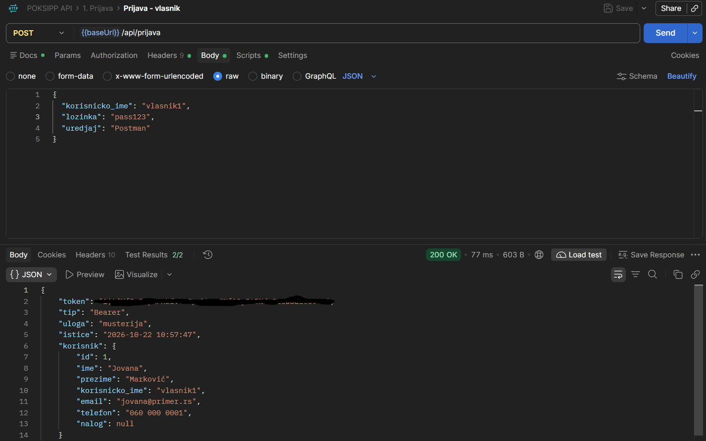

*Login through the API with the same account the owner uses in Delphi. The token is hidden.*

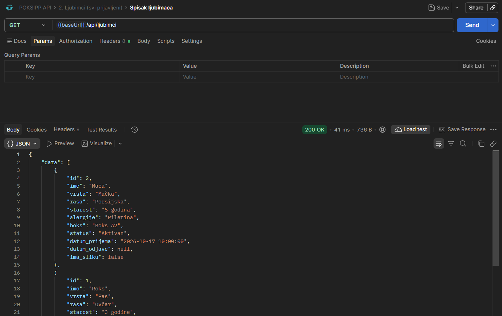

*With that token, the owner gets only their own pets.*

**4. Web page for owners.** Owners log in with the same account they use in Delphi and see their pets, the diary and the bill so far. They can upload a photo of their pet. The server turns it the right way up, shrinks it to 800 px, removes metadata (including GPS location) and saves it where staff see it in Delphi. It was the first piece of data created in the new system and used by the old one.

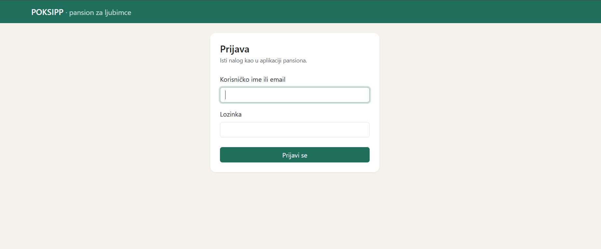

*Owners log in with the same account as in the boarding house app.*

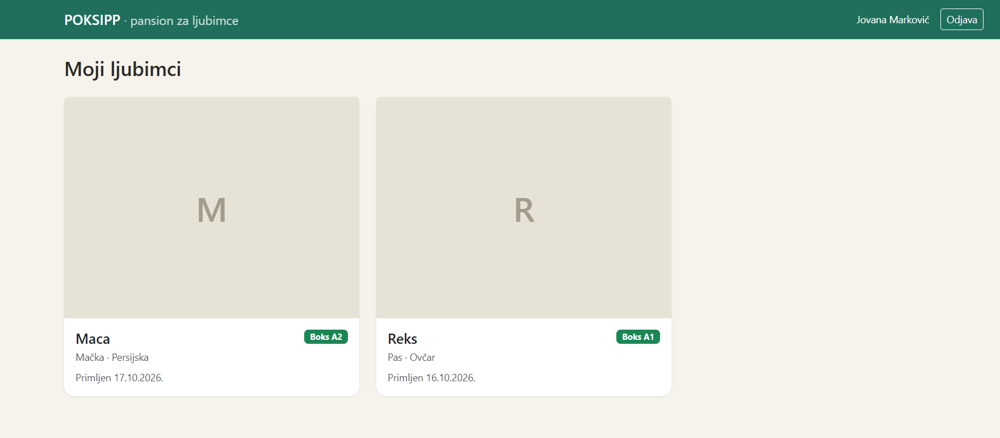

*Each owner sees only their own pets, with the box and the check-in date.*

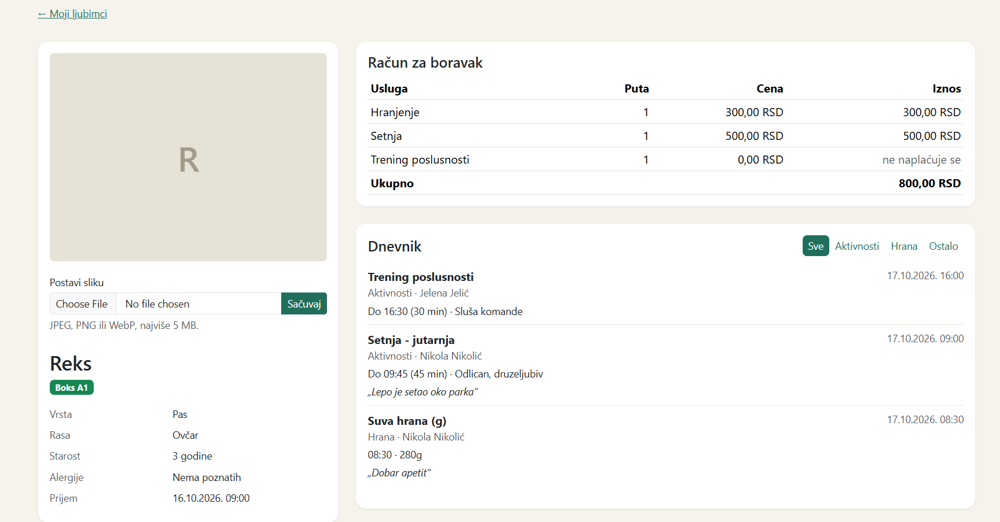

*The pet page shows the bill so far and the diary. The free activity is listed as "not charged", and the comments staff wrote at the end of each activity are visible to the owner.*

**Docker.** One command (`docker compose up`) starts the web page, the API and a MariaDB database with demo data, on any machine. The demo data is invented, so the project can be shown and published without real people in it.

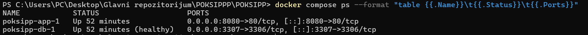

*Both containers running, with the database reported as healthy.*

## Proving it works

All 10 control scenarios passed, the 49 automated tests pass, and the migration checksums match for every table.

**Control scenarios.** Each scenario does something in one app and checks the result in the other. This is characterization testing: the old app's behaviour is the specification.

| # | Done in | Checked in | What must hold |
| --- | --- | --- | --- |
| 1 | Delphi | web, API | A pet checked in at Delphi shows up on the owner's page |
| 2 | API, Delphi | both | A taken box is refused in both apps, nothing is written |
| 3 | Delphi | web | An activity shows "in progress", then its end time and length |
| 4 | Delphi | API, Delphi | No check-out while an activity is running |
| 5 | Delphi | API, web | A 280 g meal lowers stock by exactly 280; too large a meal leaves no trace |
| 6 | Delphi | API | A deactivated worker's valid token stops working at once (401) |
| 7 | Delphi | web, API | The same bill, item by item, in all three places |
| 8 | Delphi | web, API | Check-out frees the box and the owner sees "checked out" |
| 9 | API, Delphi | both | An account made in one app logs in to the other |
| 10 | web | Delphi, web | A photo from the web shows in Delphi; another owner gets 404 |

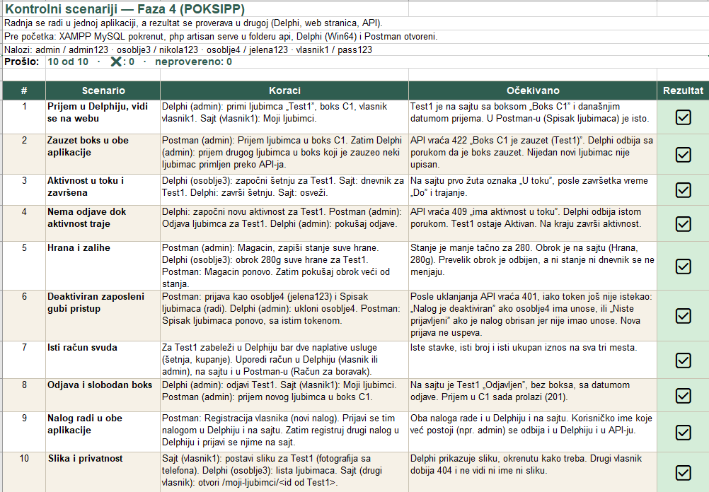

*The checklist I worked through by hand, in Serbian: 10 of 10 passed.*

**Automated tests.** The 49 automated tests run against a separate `poksipp_test` database built from the same schema file the migration uses, so they test the real schema. They cover login and roles, check-in and check-out rules, the bill, photo upload and owner privacy. A guard refuses to run them on any database whose name does not end in `_test`.

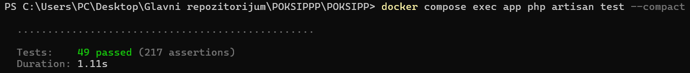

*All 49 tests pass inside Docker.*

**Checksums.** After the migration, `verify.py` compares row counts and SHA-256 checksums per table between SQLite and MySQL.

## What was hard

Most of the hard problems had nothing to do with writing new code. They came from old data and from small differences between databases, and they would have broken the app if nobody had checked.

**Old data**

- **Dates in many shapes.** SQLite has no real date type, so a date can sit in the file as text in several layouts or as a number (a Delphi date, a Julian day or Unix time). The migration understands all of them, writes one proper date, and stops on anything it does not recognize. I tested it on a copy of the database seeded with dates in four formats.
- **`admin` and `Admin`.** SQLite treats these as two different users. MySQL compares text without regard to case, so its unique key would refuse the second one. The migration looks for such duplicates before it writes anything and stops with a clear message, so they get fixed in the old data first.
- **Service `0` instead of empty.** Free activities were saved with service number 0, which does not exist. MySQL's foreign key rejected them. `NULLIF(:usl, 0)` now stores them as empty.

**Database differences**

- **"Rows affected" means something else.** In MySQL it counts only rows that actually changed. Setting the same password again reported 0 rows, and the app read that as "wrong current password". The app now rejects a new password that is the same as the current one before it runs the update.
- **TLS was required.** The client library Delphi uses (MariaDB Connector/C 3.4) will not connect without TLS. The fix was a small private certificate authority for the server. That library has no 32-bit version, so the app is now built for 64-bit Windows only.

**Business rules**

- **The bill guessed from typed text.** Staff typed the activity name and the bill matched it against the price list, so a typo meant a free walk. The activity is now picked from the price list. Free activities still show on the bill as "not charged", so the owner sees everything that was done.
- **Two admins, one box.** The Delphi app checked whether a box was free and then wrote, so two people could book the same box at the same moment. The API locks the row inside a transaction and is the safe path. Delphi still has the gap; it is the first item under "next".
- **Deactivated staff kept working.** A token stayed valid after the account was switched off. The API now reads the user's role and status on every request.
- **Photos too large for the server.** XAMPP's MySQL accepts at most 1 MB per query by default. Shrinking photos before saving fixed that and made pages faster as well.

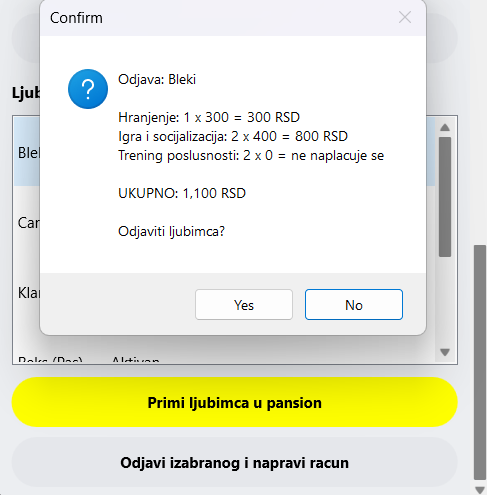

*The bill at check-out: paid services from the price list, and the free activity shown as "not charged".*

**The environment**

- **XAMPP's MySQL stopped starting.** A known MariaDB 10.4 bug fills `multi-master.info` with log lines. A small script now moves the broken file aside.
- **Docker would not start on WSL.** WSL failed with "Catastrophic failure" on this PC, so Docker Desktop runs on Hyper-V instead.
- **Tests ran against the wrong database in Docker.** Docker's environment variables overrode the test settings. They are now forced in `phpunit.xml`, which also covers `$_SERVER` because Laravel reads that first.

## Beyond POKSI: a toolkit for older formats

POKSI started on SQLite, but the clients I want to help often keep their data in something older. So I built two small Python tools that use the same method as the POKSI migration: look first, import in one transaction, then prove the result with checksums. The code is in its own repository: [StariFormati](https://github.com/Keks20/StariFormati).

**dBase / Clipper (`.dbf`).** I tested on a real Clipper sample with 500 rows, and on an invented Serbian warehouse file from the 1990s with the problems such files really have:

- **The code page is not stored in the file.** Serbian letters were written in DOS code page 852. Read with the wrong code page, the import "succeeds" and "Šećer" quietly becomes garbage. No error, and even the checksum agrees, because both sides read it the same wrong way. So the tool first shows a preview of the same text in five code pages, and a person picks the one that reads correctly.
- **The standard library hides bad values.** `dbfread` turns a number that overflowed its field (`*****`) into an empty value without a word, stops the whole import on 30 February, and reads money as floating point. The tool uses its own parser instead: money stays exact, and every unreadable value becomes empty *and* goes on a problem list (row, field, raw value, reason) for the client to decide.
- **Deleted is not deleted.** dBase only marks a deleted record until someone packs the file. Those records are imported and flagged, because they may be exactly what the client is looking for.

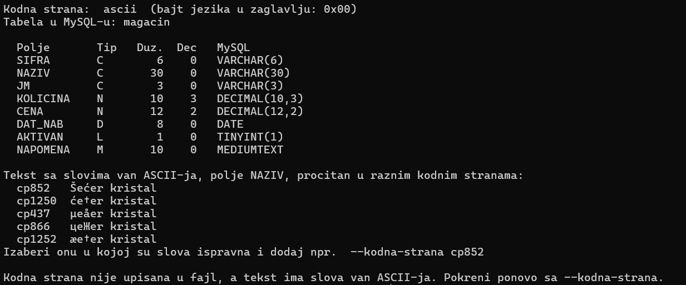

*The same product name read in five code pages. Only cp852 gives the correct "Šećer kristal", and nothing in the file says so.*

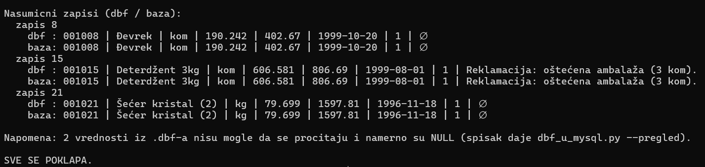

*The check compares random records side by side and ends with "everything matches". The two unreadable values are counted, not hidden.*

**Microsoft Access (`.mdb`, `.accdb`).** I tested on Microsoft's Northwind sample in Access 97 format: 9 tables, 4,032 rows, including employee photos.

- **The new driver cannot open old files.** Microsoft's current Access driver does not read Access 97. The old 32-bit Jet driver that ships with Windows does, so the tool runs on 32-bit Python. On a PC with Microsoft 365, the newer driver is also locked to Office and refuses outside programs.
- **Two independent readers.** I read the same file with Microsoft's driver on Windows and with the open-source mdbtools on Linux. On 7 of the 9 tables both gave identical checksums, including the employee photos. On the eighth, the comparison caught a bug in mdbtools: it misreads Access "Single" numbers, so a 5% discount came out as a number close to zero. The ninth table mdbtools could not open at all, because of the "ä" in its name (Umsätze).
- **Only data moves.** Queries, forms, reports and VBA are application logic and get rewritten in the new app. Table relationships are copied by hand from Access and added as foreign keys only after the data is checked against them.

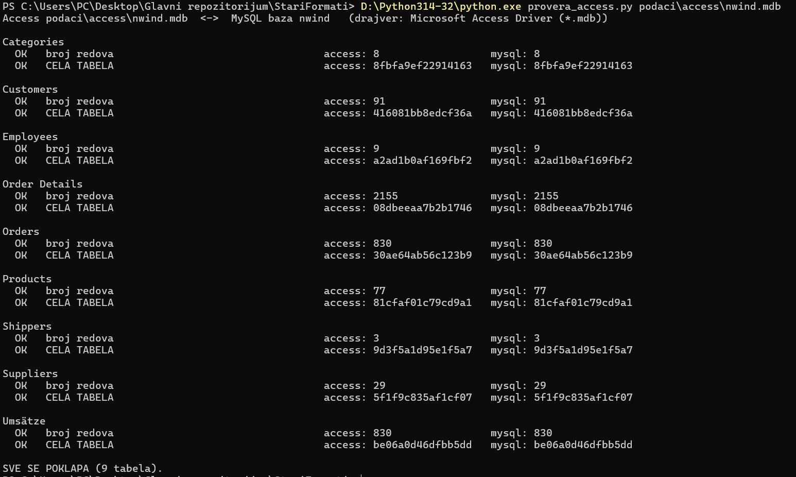

*Northwind from Access 97: row counts and checksums match for all 9 tables.*

Both tools refuse to overwrite existing tables unless asked to, and both have a matching checker that ends with "everything matches" or lists each difference.

## Results and what I would do next

**Where POKSI is now**

- The Delphi app works as before. Owners now have a web page and the data is reachable through an API, all three on one MySQL database.
- The data moved with nothing lost, and the checksums prove it.
- 18 of the 19 audit bugs were fixed before the move, and the move itself turned up 6 more, all fixed.
- 49 automated tests and 10 control scenarios cover the rules that matter most: boxes, activities, food stock, the bill and owner privacy.
- With Docker, the whole system starts with one command, with demo data and no personal data.

**What I would do next**

1. **Close the last double-booking gap.** Move box booking in Delphi into a transaction with a row lock, the same way the API already does it.
2. **Let Delphi call the API instead of the database.** Then the business rules live in one place, and the database password no longer has to sit on every staff PC.
3. **Move the remaining screens to the web, one at a time.** Each screen moves only when its scenarios pass in both apps. When the last one moves, the Delphi app can retire without a big-bang switch.
4. **Put it on a server.** It runs locally today. The Docker setup is the starting point for a small VPS with backups and HTTPS.
5. **Stronger password hashing.** Passwords are stored as SHA-256 hashes, so Delphi and the API can check the same accounts. The next step is a slow, salted hash (bcrypt or Argon2) in both apps.

**What I take from this**

The main skill was not a language or a framework. It was knowing what the old system really does before changing it: the audit first, scenarios that both versions must pass, and checksums instead of "it looks fine". The same method worked for SQLite, for dBase files from the 1990s and for Access 97, and I would use it for the next legacy system too.
